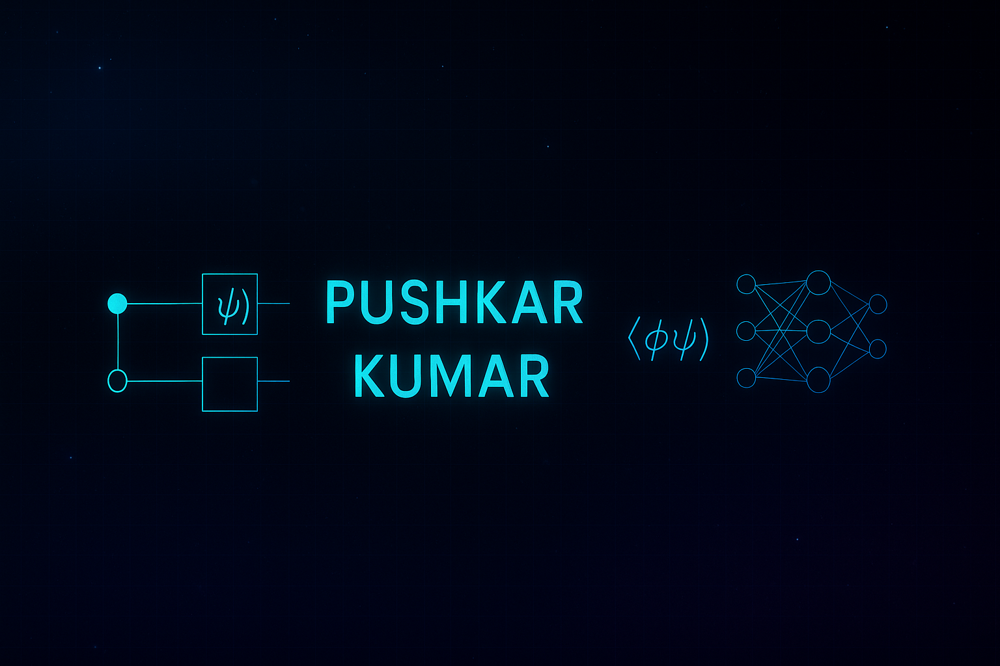

<!-- Banner -->

<h1 align="center">Hi 👋, I'm Pushkar Kumar</h1>
<h3 align="center">⚛️ |Pushkar⟩ = α|Quantum⟩ + β|AI⟩ — Turning quantum theory and AI into real-world systems</h3>

- 🎓 **B.Tech Computer Science** at **MIT ADT University**, Pune — AI & Edge Computing major, Quantum Computing minor (2028)
- ⚛️ **IBM Certified Quantum Developer (Qiskit v2.X)** · **IBM Qiskit Advocate** · **Technical Team Lead**, QQuEST · **Lead Organizer**, Qiskit Fall Fest 2026
- 🏆 **Kaggle QEC Decoder Hackathon 2026** (`0.04483` Private MAE on `[[18,4,4]]` qLDPC codes) · **QIntern 2026** (QWorld) · **WISER Global Quantum+AI Program** (Moderna challenge)
- 🧠 Building **[qecscreen](https://github.com/Pushkar0997/qecscreen)** (qLDPC code screening), **[PravahaQ](https://github.com/Pushkar0997/PravahaQ)** (3-body HUBO control plane), **[Pramana AI](https://pramana-ai-eta.vercel.app)**, **[RepoBridge](https://repobridge.pushkarkumar.me)**, and **[Quantum Arcade](https://quantum-arcade.web.app/)**
- 📊 Every project below says what can be checked — including the ones where the answer is "not yet" or undergoing a clean-core mathematical rebuild
- 🌐 Full case studies with the limitations included → **[pushkarkumar.me](https://pushkarkumar.me)**

---

## 🧭 About Me

I work where **physics, math, and computer science** meet — quantum error correction and hybrid optimization on one side, production machine learning and autonomous agent systems on the other.

Most of what I do comes down to the same thing: making a system's real behaviour visible. That means building the control that tells you *which* component failed, catching the data leakage or unconstrained edge case in your own result before someone else does, and reporting the number you got rather than the number you wanted.

I like to:
- Design and benchmark **quantum error correction decoders and optimization pipelines** at the circuit level — `[[n, k, d]]` qLDPC syndrome decoding (`Stim`, BP+OSD), 3-body HUBO/QUBO formulations, and variational/counterdiabatic solvers
- Build **spec-driven AI & ML systems**: explicit contracts (`BRIEF.md` → `CONTRACT.md`), deterministic test gates, distributed multi-GPU training, and live deployments
- Turn ideas from **papers, hackathons, and research cohorts** into working, measured prototypes that run within real hardware constraints
- Write things up so a reader can **check the claims** from a clean clone instead of taking them on trust

---

## 🛠️ Tech Stack

### Languages & Core Systems

### Quantum Computing & Scientific Computing

### Machine Learning & Agent Systems

### Web, Cloud & DevOps

---

## 🚀 What I'm Building

### 🛡️ qecscreen — [repo](https://github.com/Pushkar0997/qecscreen)

Circuit-level screening harness for quantum LDPC code search. Replaces the analytical $kd^2/n$ proxy with learned ranking over `Stim` circuit-level syndrome simulations so candidate codes are filtered by actual logical error behavior before burning full Monte Carlo budgets. Milestone 0 is closed and published (`Apache-2.0`, `CITATION.cff`, `NARRATIVE.md`); Milestone 1 ranking benchmarks are next.

### ⚡ Pramana AI (प्रमाण) — [live](https://pramana-ai-eta.vercel.app) · [pitch deck](https://pramana-ai-eta.vercel.app/deck/index.html) · [repo](https://github.com/Pushkar0997/pramana-ai)

Autonomous multimodal checkout QA, conversion-leakage, and self-healing engineering agent built with Team Vimarsha for **Startup Buildathon India 2026**. Scrapes live public HTML DOMs alongside deterministic sandbox fixtures to produce visual bug proofs and ready-to-merge GitHub PR diffs in 60 seconds, backed by 24/24 CI unit tests.

### 🌉 RepoBridge — [live beta](https://repobridge.pushkarkumar.me) · [repo](https://github.com/Pushkar0997/RepoBridge)

Turns a public GitHub repository into grounded, traceable context for LLM workflows. Every file is accounted for, every omission carries a reason, and the shared public demo publishes its exact operational limits upfront (20 analyses/hour globally, 5/visitor, up to 5,000 tree entries and 100 files read per run) rather than hiding them behind silent truncation.

### 🎮 Quantum Arcade — [live](https://quantum-arcade.web.app/)

Learn quantum computing the way you'd learn a language: short interactive levels with immediate feedback and real statevector evaluation underneath rather than scripted animations. Start at Level 1 in the browser, no account needed.

### 🗂️ Smriti — [live](https://smriti-indol.vercel.app) · [repo](https://github.com/Pushkar0997/Smriti) & Smriti Vault — [repo](https://github.com/Pushkar0997/smriti-vault)

- **Smriti**: Citation-grounded RAG study assistant for MIT-ADT students built on real university PYQs and notes rather than generic textbook prose.
- **Smriti Vault** (*UGREEN AI NAS Hackathon 2026*): On-device Cross-Document Commitment & Conflict Ledger that reconciles contracts, invoices, whiteboard scans, and voice notes into a SHA-256 source-linked dossier across a 5-state epistemic taxonomy (`CONFIRMED`, `CONFLICTING`, `SUPERSEDED`, `UNVERIFIED_MENTION`, `MISSING_IN_SCOPE`).

### ⚛️ PravahaQ — [repo](https://github.com/Pushkar0997/PravahaQ) *(Clean-Core Rebuild in Progress)*

Hybrid HPC-Quantum 3-Body HUBO optimization engine and control plane (`pravaha_q` / `Vaisheshika-3Local`) for coupled Edge-AI inference routing and 3-phase microgrid thermal dispatch. *Audit status:* after pushing the initial 8-batch scaffold, a forensic mathematical audit caught an unconstrained $y_{n,0}$ edge case when $R=1$ in `hubo_builder.py`, a Pauli-$Y$ sign inversion in the counterdiabatic term, and stubbed solver adapters. Currently executing a 9-step clean-core rebuild with a standalone `ScheduleValidator` strictly separated from `SolverStatus`.

---

## 🔬 Selected Work & Benchmarks

### 🧮 `[[18,4,4]]` qLDPC Syndrome Decoder — Kaggle QEC Decoder Hackathon 2026
Custom from-scratch `float32` normalized Min-Sum Belief Propagation (5 iterations, $\alpha = 0.8$) + GF(2) Ordered Statistics Decoding (`OSD-0`) built in pure `NumPy`, `SciPy`, `Numba`, and `Stim` without external QEC libraries (`ldpc` or `pymatching`), using 10,000-shot chunked decoding to stay within an 8 GB RAM ceiling under SI1000 ($p = 0.002$) circuit-level depolarizing noise. Achieved **0.04446 Public / 0.04483 Private per-observable MAE** (~6.5× lower error than the ~0.29 baseline; local validation shot LER **0.079915** across 200,000 sampled shots).

`Repo:` [qec-decoder-hackathon-2026](https://github.com/Pushkar0997/qec-decoder-hackathon-2026)

### ⚛️ Quantum Document Pipeline — QIntern 2026, QWorld
FRQI/NEQR encoding, a quanvolutional feature layer, and a Grover comparator oracle, benchmarked against Tesseract with 30-split significance testing. An earlier run of mine reported a +1.4 point gain — the angle search had touched rows that later appeared in the test set, and re-running with a sealed partition brought it to +0.1. Both numbers are in the report.

Reproduces from a clean clone in under a minute. Scoped for three people; all 23 commits are mine.

`Repo:` [qi26_25](https://github.com/Pushkar0997/qi26_25) · [Live demo](https://pushkar0997.github.io/qi26_25/) · [Report](https://github.com/Pushkar0997/qi26_25/blob/main/docs/final_report.md)

### 🧬 RNA Folding with Quantum Optimization — WISER × Moderna challenge
CVaR-VQE reproduces ViennaRNA's exact minimum-free-energy structure at a 0.000 kcal/mol gap, holding across 35 runs under shot and depolarizing noise. Where it missed, exhaustive brute force over the same QUBO missed identically — proving the limitation was in the formulation, not the optimizer.

`Repo:` [Moderna-Quantum-RNA](https://github.com/Harold-Ohandja/Moderna-Quantum-RNA-) · [Interactive explainer](https://harold-ohandja.github.io/Moderna-Quantum-RNA-/)

### ⚡ Distributed Training on GCP Vertex AI & Veritas AI v2
Multi-GPU Longformer fine-tuning with a self-relaunching `accelerate` topology, rank-gated tokenization behind a barrier file, explicit NCCL configuration, and a four-destination checkpoint strategy. Plus a cheap smoke test that validates IAM and GCS access before any GPU spins up — written after a silent deadlock ran unattended for twenty hours and produced nothing. Powers **Veritas AI v2**, which fixes v1's train/inference global attention mask mismatch across ISOT, LIAR, and FEVER.

`Repos:` [vertex-pytorch-trainers](https://github.com/Pushkar0997/vertex-pytorch-trainers) · [veritas_ai_v2](https://github.com/Pushkar0997/veritas_ai_v2) · [HF Model](https://huggingface.co/PushkarKumar/veritas_ai_v2)

### 🌿 Plant Disease Detection (DenseNet-169)
Two-stage pipeline: contour/HSV localisation, then DenseNet-169 across 15 PlantVillage classes. 97.8% accuracy, 97.7% macro F1 on 4,134 images — though validation drove checkpoint selection, so that number is optimistically biased and I say so. The confidence floor was chosen by measurement: my first instinct of 0.40 would have suppressed zero errors, so it ships at 0.80.

`Repo:` [plant-disease-densenet169](https://github.com/Pushkar0997/plant-disease-densenet169) · [Demo](https://huggingface.co/spaces/PushkarKumar/plant-disease-densenet169) · [Model](https://huggingface.co/PushkarKumar/plant-disease-densenet169)

### 🛰️ Additional Systems, Curricula & Prototypes
- **From Classical Optimization to QUBO**: 6-module from-scratch Python curriculum covering LP/MIP, metaheuristics, quadratic penalties, QUBO formulations, and an industry-grade capstone — [optimization-to-qubo](https://github.com/Pushkar0997/optimization-to-qubo)
- **SatQuery (ISRO SIH26167)**: Natural-language retrieval over satellite imagery archives grounded in retrieved visual evidence — [satquery](https://github.com/Pushkar0997/satquery)
- **Qiskit v2.X Certification Prep & Quantum Foundations**: Task-by-task notebooks for the IBM Certified Quantum Developer exam — [Qiskit_cert_prep](https://github.com/Pushkar0997/Qiskit_cert_prep) · [quantum-toybox](https://github.com/Pushkar0997/quantum-toybox) · [quantum-battery-lab](https://github.com/Pushkar0997/quantum-battery-lab)
- **Applied AI & Systems Engineering**: [dark-factory-gemini](https://github.com/Pushkar0997/dark-factory-gemini) (WeAreDevelopers × BAND coding agent) · [ai-notetaker](https://github.com/Pushkar0997/ai-notetaker) (offline Windows Vosk classroom transcriber) · [tathya](https://github.com/Pushkar0997/tathya) (source-verified public metrics ledger) · [brics-pay](https://github.com/Pushkar0997/brics-pay) (federated cross-border payment rail architecture)

More at [github.com/Pushkar0997](https://github.com/Pushkar0997) · Full case studies at [pushkarkumar.me](https://pushkarkumar.me)

---

### 📊 GitHub Stats & Activity

  
  

  

---

## 🌐 Connect & Collaborate

Currently available for **contract ML engineering**, **quantum algorithm & QEC work**, and **research collaboration**.

I'm always open to:
- Collaborating on **quantum error correction (`qLDPC`)**, **hybrid quantum optimization**, or **ML research** projects
- Contributing to **open source** and learning through real-world PRs
- Talking about ideas at the intersection of **physics, AI, and real-world systems**

  
  
  
  

